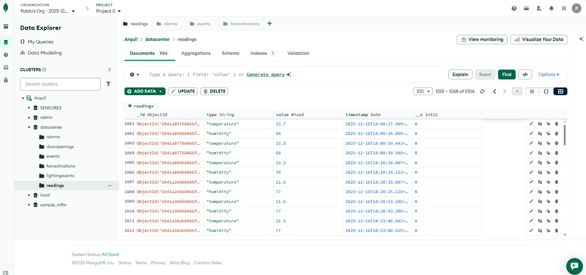
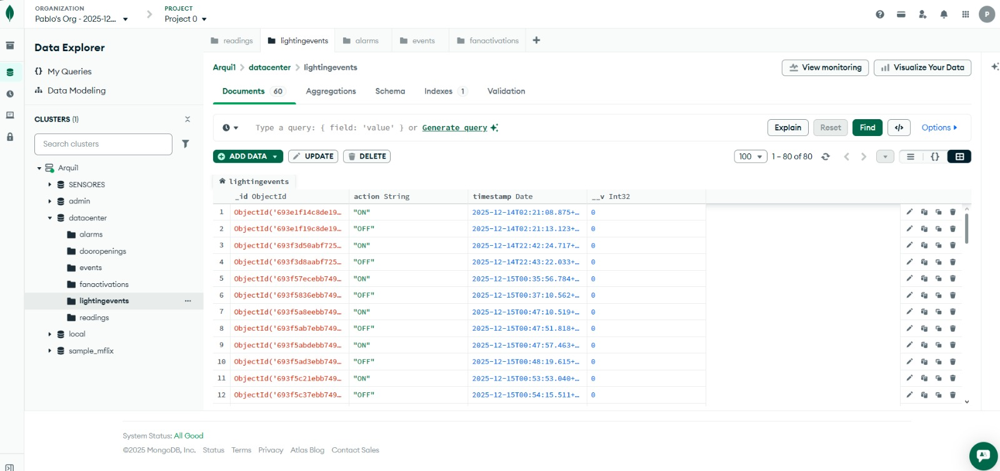
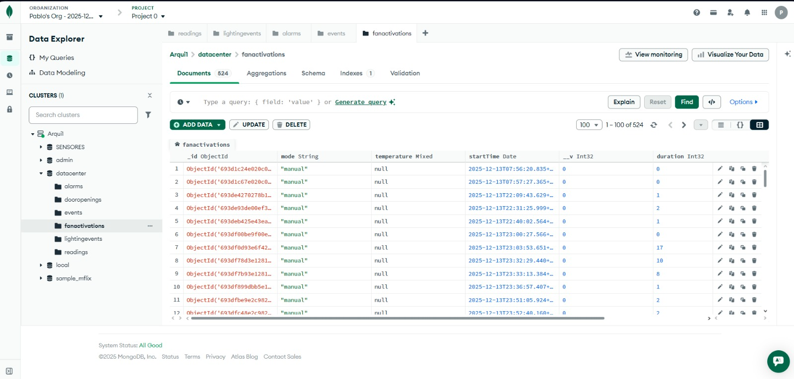
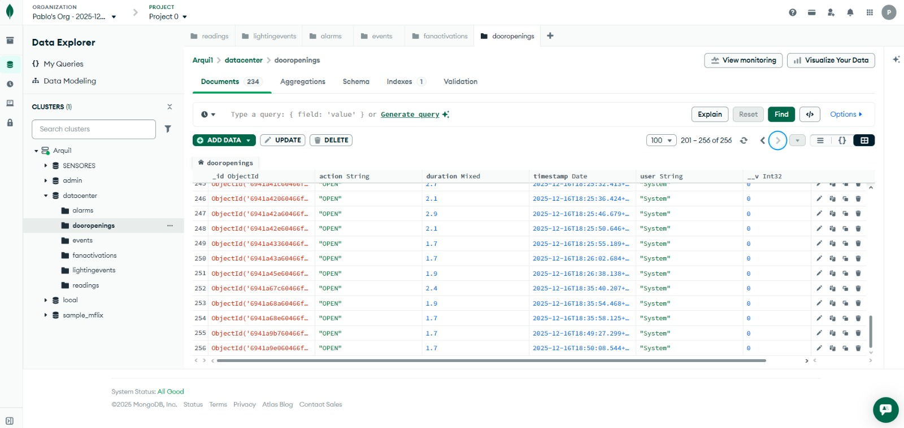
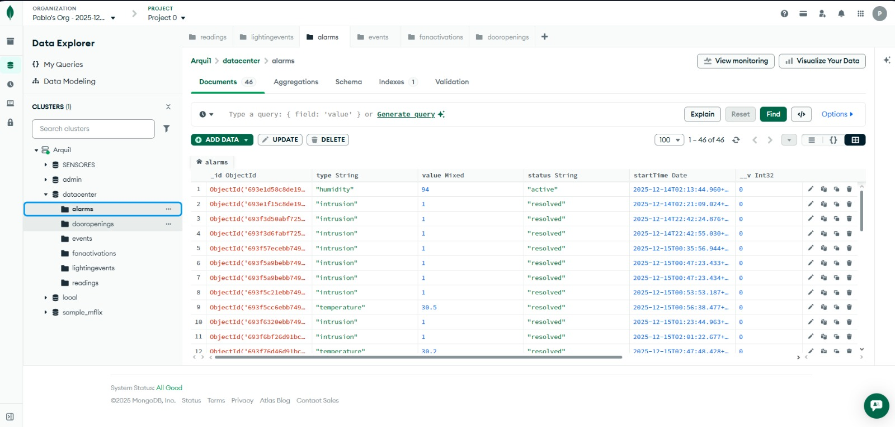

# Manual Técnico del Sistema de Monitoreo DataCenter FIUSAC

## Índice

1. [Introducción](#1-introducción)
2. [Objetivos Generales](#2-objetivos-generales)
3. [Objetivos Específicos](#3-objetivos-específicos)
4. [Arquitectura del Sistema](#4-arquitectura-del-sistema)
5. [Tecnologías Utilizadas](#5-tecnologías-utilizadas)
6. [Frameworks Utilizados](#6-frameworks-utilizados)
7. [Requerimientos para el Desarrollo y Ejecución](#7-requerimientos-para-el-desarrollo-y-ejecución)
8. [Componentes del Sistema](#8-componentes-del-sistema)
9. [Funcionamiento Detallado](#9-funcionamiento-detallado)
10. [Instalación y Configuración](#10-instalación-y-configuración)
11. [Propuesta de Mejoras](#11-propuesta-de-mejoras)
12. [Conclusiones](#12-conclusiones)

---

## 1. Introducción

Este documento presenta el manual técnico para el **Sistema de Monitoreo DataCenter FIUSAC**, desarrollado como parte del Proyecto 1 del curso de Arquitectura de Computadoras y Ensambladores 1. El sistema está diseñado para el monitoreo en tiempo real y control automatizado de las condiciones ambientales y de seguridad del Data Center de la Facultad de Ingeniería de la Universidad de San Carlos de Guatemala.

El proyecto implementa una solución integral que combina hardware IoT (Raspberry Pi), comunicación MQTT, almacenamiento en la nube (MongoDB) y una interfaz web moderna para proporcionar supervisión 24/7 del datacenter. La arquitectura modular permite escalabilidad, mantenimiento eficiente y alta disponibilidad del sistema.

### Equipo de Desarrollo

| Nombre | Carnet |
|--------|--------|
| Yeison Omar López Dueñas | 202102688 |
| Héctor Antonio Cardona Cos | 202307354 |
| Ottoniel Fabrico Vásquez Pineda | 202307820 |
| Pablo Daniel Velásquez Hernández | 202302232 |
| Diego Eduardo España Vásquez | 202307716 |

---

## 2. Objetivos Generales

* **Desarrollar un sistema integral de monitoreo y seguridad** para el Data Center de la Facultad de Ingeniería USAC
* **Garantizar la disponibilidad continua** de los servicios del datacenter mediante monitoreo automatizado 24/7
* **Facilitar la visualización en tiempo real** de métricas ambientales, estados de dispositivos y alertas críticas
* **Permitir el control remoto y automatizado** de actuadores y sistemas de seguridad a través de una interfaz web intuitiva
* **Establecer una comunicación eficiente y escalable** entre todos los componentes del sistema mediante el protocolo MQTT
* **Prevenir interrupciones y daños** en los equipos del datacenter a través de monitoreo predictivo y alertas tempranas

---

## 3. Objetivos Específicos

* **Frontend React:** Implementar una interfaz de usuario intuitiva, responsive y moderna utilizando React.js para la interacción con el sistema de monitoreo
* **Backend Node.js:** Crear un servicio backend robusto con Node.js y Express.js que gestione la comunicación MQTT, la persistencia de datos y proporcione una API REST para el frontend
* **Base de Datos MongoDB:** Diseñar y configurar un esquema de base de datos NoSQL optimizado para almacenar datos de sensores, estados de dispositivos y logs históricos
* **IoT Raspberry Pi:** Desarrollar scripts en Python para dispositivos Raspberry Pi que publiquen datos de sensores (DHT11, PIR) y se suscriban a comandos de control vía protocolo MQTT
* **Visualización de Datos:** Integrar gráficos interactivos y dashboards en tiempo real utilizando Recharts para una comprensión clara del estado del datacenter
* **Sistema de Alertas:** Implementar un sistema de notificaciones automáticas basado en umbrales configurables para temperatura, humedad y detección de movimiento
* **Seguridad y Autenticación:** Establecer mecanismos de autenticación y autorización para proteger el acceso al panel de control
* **Comunicación MQTT:** Configurar un broker MQTT (HiveMQ) para garantizar comunicación confiable y de baja latencia entre dispositivos IoT y el sistema central

---

## 4. Arquitectura del Sistema

### 4.1 Diagrama de Arquitectura

El sistema implementa una arquitectura distribuida de 4 capas:

```
┌─────────────────┐    ┌─────────────────┐    ┌─────────────────┐
│   Frontend      │    │    Backend      │    │   Raspberry Pi  │
│   React.js      │◄──►│   Node.js       │◄──►│    Python       │
│   Dashboard     │    │   Express.js    │    │   Sensores IoT  │
└─────────────────┘    └─────────────────┘    └─────────────────┘
         │                       │                       │
         │                       ▼                       │
         │              ┌─────────────────┐              │
         └─────────────►│   MongoDB       │◄─────────────┘
                        │   Base Datos    │
                        └─────────────────┘
                                 ▲
                                 │
                        ┌─────────────────┐
                        │  MQTT Broker    │
                        │   (HiveMQ)      │
                        └─────────────────┘
```

### 4.2 Flujo de Datos

1. **Recolección:** Sensores en Raspberry Pi capturan datos ambientales
2. **Transmisión:** Datos se envían vía MQTT al broker HiveMQ
3. **Procesamiento:** Backend Node.js recibe y procesa mensajes MQTT
4. **Almacenamiento:** Datos se persisten en MongoDB con timestamps
5. **Visualización:** Frontend React consulta API REST y muestra datos en tiempo real

---

## 5. Tecnologías Utilizadas

### 5.1 Backend (Node.js)

* **Node.js v18+**: Entorno de ejecución JavaScript del lado del servidor, seleccionado por su eficiencia en operaciones I/O no bloqueantes
* **Express.js v4.22**: Framework web minimalista para Node.js, utilizado para construir la API REST con endpoints optimizados
* **Mongoose v9.0**: ODM (Object Document Mapper) para MongoDB, proporciona validación de esquemas y abstracción de base de datos
* **MQTT.js v5.14**: Cliente MQTT para Node.js, maneja la comunicación bidireccional con el broker y dispositivos IoT
* **MongoDB**: Base de datos NoSQL orientada a documentos, ideal para almacenar datos de sensores con estructura flexible
* **Axios v1.13**: Cliente HTTP basado en promesas para realizar solicitudes externas y comunicación entre servicios
* **CORS v2.8**: Middleware para Express.js que habilita Cross-Origin Resource Sharing, permitiendo comunicación frontend-backend
* **Dotenv v17.2**: Módulo para gestión segura de variables de entorno y configuraciones sensibles

### 5.2 Frontend (React.js)

* **React v18.3**: Librería de JavaScript para construir interfaces de usuario dinámicas con componentes reutilizables
* **React Router DOM v7.10**: Librería para enrutamiento declarativo en aplicaciones SPA (Single Page Application)
* **Recharts v2.5**: Librería de gráficos composable construida específicamente para React, integrada con D3.js
* **Axios v1.13**: Cliente HTTP para realizar solicitudes a la API REST del backend con manejo de promesas
* **Lucide-React v0.263**: Colección de iconos SVG ligeros, personalizables y optimizados para React
* **React Scripts v5.0**: Herramientas de build y desarrollo para aplicaciones React sin configuración manual

### 5.3 Hardware IoT (Raspberry Pi)

**Librerías Python implementadas:**

* **RPi.GPIO v0.7.1**: Librería para control de pines GPIO de Raspberry Pi, interfaz con sensores y actuadores
* **adafruit-circuitpython-dht v4.0.10**: Driver oficial para sensor DHT11, lectura precisa de temperatura y humedad
* **RPLCD v1.4.0**: Librería para control de displays LCD I2C en Raspberry Pi con soporte PCF8574
* **Adafruit-Blinka v8.68.0**: Capa de compatibilidad CircuitPython para Raspberry Pi
* **smbus2 v0.5.0**: Comunicación I2C para LCD y otros dispositivos
* **pyserial v3.5**: Comunicación serial para interfaces UART
* **rpi_ws281x v5.0.0**: Control opcional de LEDs NeoPixel RGB direccionables

**Hardware integrado:**

* **Sensor DHT11**: Temperatura (0-50°C) y humedad (20-90%) con protocolo single-wire
* **Pantalla LCD 20x4 I2C**: Display alfanumérico con dirección 0x27
* **Servomotor SG90**: Control PWM para rotación 0-180° en GPIO 12
* **Motor DC**: Ventilador de enfriamiento controlado por GPIO 15
* **Sensor Infrarrojo PIR**: Detector de movimiento en GPIO 26
* **LEDs indicadores**: RGB, blanco, verde, azul para alertas visuales
* **Buzzer activo 5V**: Alarma sonora en GPIO 6

### 5.4 Comunicación y Servicios

* **HiveMQ Cloud**: Broker MQTT en la nube con certificados SSL/TLS, garantiza comunicación segura y confiable
* **SSL/TLS**: Protocolo de encriptación para comunicaciones MQTT seguras
* **JSON**: Formato de intercambio de datos entre frontend, backend y dispositivos IoT

---

## 6. Frameworks Utilizados

### 6.1 Backend Framework

* **Express.js v4.22**: Framework web rápido, minimalista y flexible para Node.js
  -Manejo de rutas REST (GET, POST, PUT, DELETE)
  -Middleware personalizable para autenticación, CORS y logging
  -Integración nativa con sistemas de templates y bases de datos

### 6.2 Frontend Framework

* **React v18.3**: Librería/Framework para construcción de interfaces de usuario

  -Componentes funcionales con Hooks (useState, useEffect, useContext)
  -Virtual DOM para renderizado eficiente
  -Ecosystem robusto con React Router para SPA

### 6.3 Herramientas de Desarrollo

* **Create React App (react-scripts v5.0)**: Herramienta oficial para scaffolding de proyectos React

  -Configuración de Webpack y Babel preconfigurada
  -Hot reloading para desarrollo
  -Optimizaciones de build para producción

---

## 7. Requerimientos para el Desarrollo y Ejecución

### 7.1 Entorno de Desarrollo

* **Node.js**: Versión 18.0 o superior (LTS recomendado)
* **npm**: Versión 9.0 o superior (incluido con Node.js)
* **Python**: Versión 3.8 o superior para scripts de Raspberry Pi
* **pip**: Versión 22.0 o superior para gestión de paquetes Python
* **Git**: Sistema de control de versiones para colaboración
* **Editor de Código**: Visual Studio Code recomendado con extensiones:
  -ES7+ React/Redux/React-Native snippets
  -Python extension
  -MongoDB extension

### 7.2 Servicios y Infraestructura

* **MongoDB Atlas** (Opcional): Cluster gratuito M0 o superior para base de datos en la nube
* **HiveMQ Cloud** (Opcional): Broker MQTT gratuito con SSL/TLS para integración web
* **Raspberry Pi**: Modelo 3B+ o superior con Raspberry Pi OS (Bullseye o posterior)
* **Hardware Sensores Implementados**:
  -DHT11 (temperatura 0-50°C y humedad 20-90%)
  -Sensor Infrarrojo PIR (detección de movimiento)
  -LCD I2C 20x4 (dirección 0x27)
  -Servomotor SG90 (torque 1.8 kg/cm)
  -Motor DC con driver para ventilador
  -LEDs RGB, blanco, verde, azul, rojo
  -Buzzer activo 5V

### 7.3 Conectividad de Red

* **Internet**: Conexión estable para servicios en la nube
* **WiFi/Ethernet**: Para comunicación Raspberry Pi
* **Puertos**: 3000 (frontend), 3001 (backend), 8883 (MQTTS)

### 7.4 Para Despliegue en Producción

* **Servidor VPS**: Ubuntu 20.04 LTS o superior con:
  -2GB RAM mínimo
  -20GB almacenamiento SSD
  -Certificado SSL para HTTPS
* **Reverse Proxy**: Nginx para servir frontend estático
* **Process Manager**: PM2 para mantener backend Node.js ejecutándose
* **Firewall**: UFW configurado para puertos específicos

---

## 8. Componentes del Sistema

### 8.1 Estructura del Proyecto

```s
project-1/
├── main.py                    # Programa principal de monitoreo
├── sensordht11.py            # Clase para sensor DHT11
├── servomotor.py             # Clase para servomotor SG90  
├── sensorInfrarrojo.py       # Clase para sensor PIR
├── lcd.py                    # Clase para pantalla LCD I2C
├── requirements.txt          # Dependencias Python
├── prueba_dht11.py          # Script de prueba DHT11
├── prueba_servo.py          # Script de prueba servomotor
├── MQTT_Frontend/           # Interfaz web opcional
│   ├── frontend/            # React.js dashboard
│   └── backend/             # Node.js + Express API
├── image/                   # Diagramas de conexión
│   ├── lcd.png             # Diagrama LCD I2C
│   ├── Led_RGB.png         # Diagrama LED RGB
│   ├── Servomotor.png      # Diagrama Servomotor
│   ├── motoDC.png          # Diagrama Motor DC
│   └── DHT11.png           # Diagrama Sensor DHT11
├── README.md               # Documentación de usuario
└── TECHNICAL_MANUAL.md     # Este documento técnico
```

### 8.2 Módulo Principal (`main.py`)

**Configuración de GPIO:**

```python
GPIO.setmode(GPIO.BCM)  # Numeración GPIO Broadcom
GPIO.setup(1, GPIO.OUT)   # LED blanco iluminación
GPIO.setup(6, GPIO.OUT)   # Buzzer alarma
GPIO.setup(15, GPIO.OUT)  # Motor DC ventilador
GPIO.setup(16, GPIO.OUT)  # LED azul humedad
GPIO.setup(20, GPIO.OUT)  # LED verde temperatura
GPIO.setwarnings(False)   # Desactiva advertencias
```

**Inicialización de componentes:**

```python
# Sensor DHT11 en GPIO 18
dht_sensor = DHT11Sensor(board.D18)

# Servomotor en GPIO 12, frecuencia 50Hz
servo = ServoMotor(12, 50)

# Sensor infrarrojo en GPIO 26
infrarrojo_sensor = InfrarrojoSensor(26)

# LCD I2C dirección 0x27, 20 columnas, 4 filas
lcd = LCDDisplay(0x27, 20, 4)
```

**Funciones principales:**

1. `mensaje(dht_sensor, lcd)`: Muestra lecturas en LCD (temp C°, F°, humedad)
2. `validacion_temp(dht_sensor, lcd)`: Sistema de alertas multinivel
3. `sistema_iluminacion(infrarrojo_sensor, lcd)`: Control de iluminación automática
4. `abrir_servo(servo)`: Abre acceso (180°)
5. `cerrar_servo(servo)`: Cierra acceso (0°)

### 8.3 Clase DHT11Sensor (`sensordht11.py`)

```python
import adafruit_dht
import board

class DHT11Sensor:
    def __init__(self, pin):
        """Inicializa sensor DHT11 en pin GPIO especificado"""
        self.dht = adafruit_dht.DHT11(pin)
        self.tempC = None      # Temperatura Celsius
        self.tempF = None      # Temperatura Fahrenheit
        self.humidity = None   # Humedad relativa %
    
    def read(self):
        """Lee sensor y retorna True si exitoso"""
        try:
            self.tempC = self.dht.temperature
            self.tempF = self.tempC * (9 / 5) + 32
            self.humidity = self.dht.humidity
            return True
        except RuntimeError as e:
            print(f"Error lectura DHT11: {e}")
            return False
    
    def close(self):
        """Libera recursos del sensor"""
        self.dht.exit()
```

**Características:**
-Conversión automática Celsius ↔ Fahrenheit
-Manejo robusto de RuntimeError
-Método close() para cleanup

### 8.4 Clase ServoMotor (`servomotor.py`)

```python
import RPi.GPIO as GPIO

class ServoMotor:
    def __init__(self, pin, frecuencia):
        """Inicializa servo con PWM a 50Hz"""
        self.pin = pin
        GPIO.setup(self.pin, GPIO.OUT)
        self.pwm = GPIO.PWM(self.pin, frecuencia)
    
    def iniciar(self):
        """Posición 0° (duty cycle 2.5%)"""
        self.pwm.start(2.5)
    
    def mov_90(self):
        """Posición 90° (duty cycle 7.5%)"""
        self.pwm.ChangeDutyCycle(7.5)
    
    def mov_180(self):
        """Posición 180° (duty cycle 12.5%)"""
        self.pwm.ChangeDutyCycle(12.5)
    
    def liberar(self):
        """Detiene PWM"""
        self.pwm.stop()
```

**Especificaciones PWM:**
-Frecuencia: 50Hz (periodo 20ms)
-0° = 2.5% duty cycle (0.5ms)
-90° = 7.5% duty cycle (1.5ms)  
-180° = 12.5% duty cycle (2.5ms)

### 8.5 Clase InfrarrojoSensor (`sensorInfrarrojo.py`)

```python
import RPi.GPIO as GPIO

class InfrarrojoSensor:
    def __init__(self, pin):
        """Configura pin como INPUT para sensor PIR"""
        self.pin = pin
        GPIO.setmode(GPIO.BCM)
        GPIO.setup(self.pin, GPIO.IN)
    
    def leer_estado(self):
        """Retorna 0 si detecta movimiento, 1 si no"""
        return GPIO.input(self.pin)
```

**Aplicación:** Sistema de iluminación que activa LED blanco por 5 segundos al detectar movimiento.

### 8.6 Clase LCDDisplay (`lcd.py`)

```python
from RPLCD.i2c import CharLCD

class LCDDisplay:
    def __init__(self, address, cols, rows):
        """Inicializa LCD I2C con PCF8574"""
        self.lcd = CharLCD(
            i2c_expander='PCF8574',
            address=address,    # 0x27
            port=1,            # I2C bus 1
            cols=cols,         # 20 caracteres
            rows=rows,         # 4 líneas
            charmap='A00'      # Mapa de caracteres
        )
    
    def show(self, text, line, column):
        """Muestra texto en posición específica"""
        self.lcd.cursor_pos = (line, column)
        self.lcd.write_string(text.ljust(20))
    
    def clear(self):
        """Limpia toda la pantalla"""
        self.lcd.clear()
```

**Comunicación I2C:**
-Bus I2C 1 (pines GPIO 2/3)
-Dirección: 0x27 (configurable)
-Expansor: PCF8574

### 8.7 Backend API - Node.js (Opcional)

**Ubicación:** `MQTT_Frontend/backend/`

El servidor backend proporciona integración web opcional:
-API REST para consultar datos
-Cliente MQTT para comunicación IoT
-Almacenamiento MongoDB
-CORS habilitado

**Nota:** El sistema Raspberry Pi funciona de forma autónoma sin necesidad del backend web.

### 8.8 Frontend Dashboard - React (Opcional)

**Ubicación:** `MQTT_Frontend/frontend/`

Interfaz web para visualización remota:
-Dashboard con métricas en tiempo real
-Gráficos históricos con Recharts
-Panel de control remoto
-Sistema de notificaciones

### 8.9 Esquema de Base de Datos MongoDB

La base de datos MongoDB almacena toda la información del sistema de monitoreo en colecciones especializadas.

#### 8.9.1 Colección de Humedad y Temperatura

Almacena las lecturas de humedad y temperatura del sensor DHT11.

**Esquema:**

Temperatura:

```json
{
  _id: ObjectId,
  temperature: Number,     // Temperatura en grados Celsius
  timestamp: Date,         // Fecha y hora de la lectura
}
```

Humedad:

```json
{
  _id: ObjectId,
  humidity: Number,     // Humedad relativa en porcentaje
  timestamp: Date,         // Fecha y hora de la lectura
}
```

**Ejemplo de documento:**

```json
{
  _id: ObjectId("674a3f2e1c9d440000a1b2c3"),
  temperature: 26.5,
  temperatureF: 79.7,
  timestamp: ISODate("2024-12-16T22:30:45.000Z"),
}
```



#### 8.9.2 Colección de eventos de los LEDS

Registra eventos del sistema como detección de movimiento, alertas y cambios de estado.

**Esquema:**

```json
{
  _id: ObjectId,
  action: String,      // Tipo de evento (ej: "motion_detected", "alert", "system_start")
  timestamp: Date,         // Fecha y hora del evento
}
```

**Ejemplo de documento:**

```javascript
{
  _id: ObjectId("674a3f2e1c9d440000a1b2c4"),
  action: "on",
  timestamp: ISODate("2024-12-16T22:31:15.000Z"),
}
```



#### 8.9.3 Colección de eventos del ventilador

Registra cada activación y desactivación del ventilador.

**Esquema:**

```json
{
  _id: ObjectId,
  mode: String,          // "open" o "close"
  temperature: Number,     // Ángulo del servo (0° o 180°)
  timestamp: Date,         // Fecha y hora de la operación
}
```

**Ejemplo de documento:**

```json
{
  _id: ObjectId("674a3f2e1c9d440000a1b2c6"),
  mode: "manual",
  temperature: 66,
  timestamp: ISODate("2024-12-16T22:33:10.000Z")
}
```



#### 8.9.4 Colección de eventos de la puerta

Registra las operaciones de apertura y cierre de la puerta controlada por el servomotor.

**Esquema:**

```json
{
  _id: ObjectId,
  action: String,          // "open" o "close"
  angle: float,     // Ángulo del servo (0° o 180°)
  timestamp: Date,         // Fecha y hora de la operación
}
```

**Ejemplo de documento:**

```json
{
  _id: ObjectId("674a3f2e1c9d440000a1b2c6"),
  action: "OPEN",
  angle: 1.8,
  timestamp: ISODate("2024-12-16T22:33:10.000Z")
}
```



#### 8.9.5 Colección de activaciones de alarmas

Registra todas las activaciones de alarmas del sistema.



---

## 9. Funcionamiento Detallado

### 9.1 Ciclo de Monitoreo Principal

**Flujo de ejecución:**

```python
# Loop principal ejecuta cada 1 segundo
while True:
    # 1. Lectura DHT11 cada 5 segundos
    if time.time() - ultimo_tiempo >= 5:
        mensaje(dht_sensor, lcd)
        validacion_temp(dht_sensor, lcd)
        ultimo_tiempo = time.time()
    
    # 2. Monitoreo continuo de iluminación
    sistema_iluminacion(infrarrojo_sensor, lcd)
    
    sleep(1)
    lcd.clear()
```

### 9.2 Sistema de Alertas Multinivel

**Umbrales configurables:**

```python
TEMP_CRITICA = 28.0   # Temperatura crítica °C
TEMP_ALTA = 24.0      # Temperatura alta °C
HUM_ALTA = 70.0       # Humedad alta %
```

**Niveles de alerta:**

| Nivel | Condición | Actuadores | Display LCD |
|-------|-----------|------------|-------------|
| 🟢 **Normal** | Temp < 24°C | Todo OFF | Lecturas normales |
| 🟡 **Precaución** | 24°C ≤ Temp < 28°C | Ventilador ON | "ACTIVANDO VENTILADOR" |
| 🔴 **Crítico** | Temp ≥ 28°C | Buzzer + LED verde parpadeo 1s | "ALERTA: TEMP CRITICA" |
| 🔵 **Humedad** | Hum ≥ 70% | Buzzer + LED azul parpadeo 0.4s | "ALERTA: HUMEDAD ALTA" |

**Implementación de alertas:**

```python
def validacion_temp(dht_sensor, lcd):
    if dht_sensor.tempC >= 28.00:
        # NIVEL CRÍTICO
        lcd.show("ALERTA: TEMP CRITICA", 1, 5)
        GPIO.output(6, GPIO.HIGH)  # Buzzer ON
        # LED verde parpadeo cada 1 segundo
        if time.time() - ultimo_cambio_temp >= 1:
            estado_led_temp = not estado_led_temp
            GPIO.output(20, estado_led_temp)
    
    elif dht_sensor.tempC >= 24.00:
        # NIVEL PRECAUCIÓN
        lcd.show("ACTIVANDO VENTILADOR", 1, 0)
        GPIO.output(15, GPIO.HIGH)  # Ventilador ON
        GPIO.output(6, GPIO.LOW)    # Buzzer OFF
    
    else:
        # NIVEL NORMAL
        GPIO.output(15, GPIO.LOW)  # Ventilador OFF
        GPIO.output(20, GPIO.LOW)  # LED verde OFF
        GPIO.output(6, GPIO.LOW)   # Buzzer OFF
    
    if dht_sensor.humidity >= 70.00:
        # ALERTA HUMEDAD
        lcd.show("ALERTA: HUMEDAD ALTA", 1, 0)
        # LED azul parpadeo cada 0.4 segundos
        if time.time() - ultimo_cambio_hum >= 0.4:
            estado_led_hum = not estado_led_hum
            GPIO.output(16, estado_led_hum)  # LED azul
            GPIO.output(6, estado_led_hum)   # Buzzer
```

### 9.3 Sistema de Iluminación Automática

**Lógica de funcionamiento:**

```python
def sistema_iluminacion(infrarrojo_sensor, lcd):
    if infrarrojo_sensor.leer_estado() == 0:  # Movimiento detectado
        lcd.clear()
        lcd.show("Obstaculo detectado", 0, 0)
        GPIO.output(1, GPIO.HIGH)  # LED blanco ON
        sleep(5)                   # Mantiene 5 segundos
        GPIO.output(1, GPIO.LOW)   # LED blanco OFF
    else:
        GPIO.output(1, GPIO.LOW)   # Asegura LED OFF
```

**Características:**
-Detección instantánea con sensor PIR
-Timeout automático de 5 segundos
-Indicación visual en LCD
-Ahorro de energía

### 9.4 Control de Acceso con Servomotor

**Funciones de control:**

```python
def abrir_servo(servo):
    """Abre puerta/compuerta a 180°"""
    servo.mov_180()

def cerrar_servo(servo):
    """Cierra puerta/compuerta a 0°"""
    servo.iniciar()
```

**Aplicaciones:**
-Control de acceso físico
-Apertura de ventanas para enfriamiento
-Barreras de seguridad

### 9.5 Display LCD - Mensajes del Sistema

**Formato de mensajes normales:**

```s
Línea 1: Temp: 25.3 C
Línea 2: Temp: 77.5 F  
Línea 3: Humidity: 65.2 %
Línea 4: [vacía]
```

**Formato de alertas:**

```s
Línea 1:  ALERTA: TEMP CRITICA
Línea 2: TEMPERATURA = 28.5C
Línea 3: [vacía]
Línea 4: [vacía]
```

### 9.6 Gestión de Recursos y Cleanup

**Al finalizar el programa:**

```python
finally:
    lcd.clear()              # Limpia pantalla
    GPIO.cleanup()           # Libera pines GPIO
    dht_sensor.close()       # Cierra sensor DHT11
    print("GPIO liberados.")
```

**Interrupción segura:**
-Ctrl+C capturado con `KeyboardInterrupt`
-Cleanup automático en bloque `finally`
-Recursos liberados correctamente

### 9.3 Control de Actuadores

1. **Comando Frontend**: Usuario envía comando desde interfaz web
2. **API Backend**: POST request a `/api/led/control` con estado deseado
3. **Publicación MQTT**: Backend publica comando a topic de control
4. **Ejecución Hardware**: Raspberry Pi recibe y ejecuta comando
5. **Confirmación**: Estado actualizado se envía de vuelta al sistema

---

## 10. Instalación y Configuración

### 10.1 Requisitos Previos

**Hardware Requerido:**
-Raspberry Pi (modelo 3B+, 4 o 5)
-Fuente de alimentación 5V 3A
-Tarjeta microSD 16GB+ (clase 10)
-Sensor DHT11 + resistencia pull-up 10kΩ
-LCD 20x4 con módulo I2C PCF8574
-Servomotor SG90
-Motor DC + driver L298N
-Sensor infrarrojo PIR
-LEDs (RGB, blanco, verde, azul, rojo)
-Buzzer activo 5V
-Resistencias 220Ω para LEDs
-Protoboard y cables jumper

**Software Requerido:**
-Raspberry Pi OS (Bullseye o posterior)
-Python 3.7+
-pip3
-Git (opcional)

### 10.2 Preparación de Raspberry Pi

**Paso 1 Actualizar sistema:**

```bash
sudo apt update && sudo apt upgrade -y
```

**Paso 2 Habilitar interfaces I2C y SPI:**

```bash
sudo raspi-config
```

Navegar: **3 Interface Options → I5 I2C → Yes**
Después: **Finish → Reboot**

**Paso 3 Instalar dependencias del sistema:**

```bash
sudo apt install -y python3-pip python3-dev i2c-tools libgpiod2
```

**Paso 4 Verificar I2C:**

```bash
sudo i2cdetect -y 1
```

Debe mostrar dirección **0x27** del LCD.

**Paso 5 Configurar permisos GPIO:**

```bash
sudo usermod -a -G gpio,i2c,spi $USER
```

**Importante:** Cerrar sesión y reiniciar.

### 10.3 Instalación del Proyecto

**Opción A Clonar repositorio:**

```bash
git clone https://github.com/Farot30/ACYE1_DICIEMBRE_2025_G1.git
cd ACYE1_DICIEMBRE_2025_G1
```

**Opción B Descarga manual:**

1. Descargar archivos del proyecto
2. Extraer en `/home/pi/project-1`
3. Navegar al directorio

### 10.4 Instalación de Dependencias Python

**Crear entorno virtual (recomendado)**

```bash
python3 -m venv venv
source venv/bin/activate
```

**Instalar desde requirements.txt**

```bash
pip install -r requirements.txt
```

**Verificar instalación**

```bash
pip list | grep -E "RPi.GPIO|adafruit|RPLCD"
```

Debe mostrar:

```s
RPi.GPIO                  0.7.1
adafruit-circuitpython-dht 4.0.10
RPLCD                     1.4.0
Adafruit-Blinka           8.68.0
```

### 10.5 Conexiones de Hardware

**Mapa completo de GPIO:**

| Componente | Pin GPIO | Conexión Física | Notas |
|------------|----------|-----------------|-------|
| DHT11 DATA | GPIO 18  | Pin 12 físico | Pull-up 10kΩ a 3.3V |
| LCD SDA    | GPIO 2   | Pin 3 físico  | Dirección I2C: 0x27 |
| LCD SCL    | GPIO 3   | Pin 5 físico  | Bus I2C 1 |
| Servo Signal | GPIO 12 | Pin 32 físico | PWM 50Hz |
| Motor DC   | GPIO 15  | Pin 10 físico | Via driver L298N |
| LED Blanco | GPIO 1   | Pin 28 físico | + resistencia 220Ω |
| Buzzer     | GPIO 6   | Pin 31 físico | Buzzer activo 5V |
| LED Azul   | GPIO 16  | Pin 36 físico | + resistencia 220Ω |
| LED Verde  | GPIO 20  | Pin 38 físico | + resistencia 220Ω |
| Infrarrojo | GPIO 26  | Pin 37 físico | Señal digital |

**Alimentación:**
-5V → Pines 2, 4 (LCD, Servo, Motor)
-3.3V → Pin 1 (DHT11)
-GND → Pines 6, 9, 14, 20, 25, 30, 34, 39

### 10.6 Pruebas Individuales

**Probar sensor DHT11:**

```bash
python3 prueba_dht11.py
```

Debe mostrar temperatura y humedad.

**Probar servomotor:**

```bash
python3 prueba_servo.py
```

Servo debe moverse 0°, 90°, 180°.

**Verificar LCD:**

```bash
sudo i2cdetect -y 1
# Debe mostrar 0x27
```

### 10.7 Ejecución del Sistema

**Ejecución manual:**

```bash
# Con entorno virtual activado
python3 main.py

# O con sudo si hay permisos GPIO
sudo python3 main.py
```

**Ejecución al inicio (systemd):**

```bash
# Crear servicio
sudo nano /etc/systemd/system/datacenter.service
```

Contenido:

```ini
[Unit]
Description=DataCenter Monitoring System
After=network.target

[Service]
Type=simple
User=pi
WorkingDirectory=/home/pi/project-1
ExecStart=/usr/bin/python3 /home/pi/project-1/main.py
Restart=on-failure
RestartSec=10

[Install]
WantedBy=multi-user.target
```

Habilitar servicio:

```bash
sudo systemctl daemon-reload
sudo systemctl enable datacenter.service
sudo systemctl start datacenter.service
sudo systemctl status datacenter.service
```

**Logs del servicio:**

```bash
sudo journalctl -u datacenter.service -f
```

### 10.8 Solución de Problemas

#### Error: "No se puede acceder a GPIO"

**Solución 1:** Ejecutar con sudo

```bash
sudo python3 main.py
```

**Solución 2:** Verificar permisos

```bash
groups $USER  # Debe incluir: gpio i2c spi
```

#### Error: "DHT11 Checksum error" / "RuntimeError"

-Verificar resistencia pull-up 10kΩ entre VCC y DATA
-Asegurar conexiones firmes (soldar si es protoboard)
-Aumentar intervalo de lectura a 5+ segundos
-Probar con cable más corto (< 20cm recomendado)

#### Error: "LCD no responde" / No aparece en i2cdetect

```bash
# Verificar detección I2C
sudo i2cdetect -y 1
```

Si no aparece 0x27:
-Revisar conexiones SDA (GPIO 2) y SCL (GPIO 3)
-Verificar alimentación 5V del LCD
-Ajustar potenciómetro de contraste
-Probar cambiar dirección I2C en código (0x3F alternativa)

#### Error: "Servo no se mueve" / Temblores

-Verificar alimentación 5V independiente (no del pin GPIO)
-Usar fuente externa 5V 2A para servo
-Revisar conexión señal PWM en GPIO 12
-Ajustar frecuencia exacta a 50Hz
-Agregar capacitor 100µF entre VCC y GND del servo

#### Error: "ImportError: No module named 'adafruit_dht'"

```bash
# Reinstalar dependencias
pip install --upgrade -r requirements.txt

# O módulo específico
pip install adafruit-circuitpython-dht
```

#### Sensor DHT11 lee siempre 0 o valores incorrectos

-Verificar pin correcto: GPIO 18 (pin físico 12)
-Resistencia pull-up 10kΩ OBLIGATORIA
-No mezclar 3.3V y 5V (DHT11 usa 3.3V en este proyecto)
-Esperar 2 segundos entre lecturas mínimo

### 10.9 Configuración Web Opcional (MQTT Frontend)

**Si se desea integración web:**

**Backend (Node.js):**

```bash
cd MQTT_Frontend/backend
npm install
cp .env.example .env
# Editar .env con credenciales MQTT y MongoDB
npm start
```

**Frontend (React):**

```bash
cd MQTT_Frontend/frontend
npm install
npm start  # Desarrollo
npm run build  # Producción
```

**Nota:** El sistema Raspberry Pi funciona completamente autónomo sin necesidad del frontend web.

### 10.10 Monitoreo del Sistema

**Ver proceso en ejecución:**

```bash
ps aux | grep main.py
```

**Detener sistema:**

```bash
# Desde terminal: Ctrl + C
# Si está en background:
pkill -f main.py

# Por systemd:
sudo systemctl stop datacenter.service
```

**Reiniciar sistema:**

```bash
sudo systemctl restart datacenter.service
```

---

## 11. Propuesta de Mejoras

### 11.1 Mejoras Técnicas Inmediatas

**Autenticación y Autorización**
-Implementar JWT (JSON Web Tokens) para autenticación
-Sistema de roles (admin, operador, solo lectura)
-Integración con LDAP/Active Directory para usuarios institucionales

**Base de Datos y Persistencia**
-Migrar a esquema relacional (PostgreSQL) para mejor integridad
-Implementar índices para optimizar consultas históricas
-Sistema de backup automatizado con retención configurable

**Monitoreo Avanzado**
-Integración con Prometheus/Grafana para métricas detalladas
-Logs estructurados con ELK Stack (Elasticsearch, Logstash, Kibana)
-Health checks automáticos para todos los servicios

### 11.2 Mejoras de Funcionalidad
**Inteligencia Artificial**
-Algoritmos de machine learning para predicción de fallos
-Detección de anomalías basada en patrones históricos
-Optimización automática de consumo energético

**Alertas Inteligentes**
-Integración con servicios de notificación (Slack, Teams, SMS)
-Escalamiento automático de alertas basado en criticidad
-Dashboard ejecutivo con KPIs del datacenter

**Expansión de Hardware**
-Soporte para múltiples Raspberry Pi distribuidas
-Integración con UPS para monitoreo de energía
-Cámaras de seguridad con detección facial
-Sensores de calidad del aire y nivel de ruido

### 11.3 Mejoras de Arquitectura

**Microservicios**

```s
┌─────────────────┐    ┌─────────────────┐    ┌─────────────────┐
│   Gateway API   │    │  Auth Service   │    │ Sensor Service  │
│   (Kong/Nginx)  │◄──►│   (OAuth2)      │◄──►│  (Dedicated)    │
└─────────────────┘    └─────────────────┘    └─────────────────┘
         │                       │                       │
         ▼                       ▼                       ▼
┌─────────────────┐    ┌─────────────────┐    ┌─────────────────┐
│ Alert Service   │    │ Data Service    │    │ Control Service │
│  (Real-time)    │    │  (Analytics)    │    │ (Actuators)     │
└─────────────────┘    └─────────────────┘    └─────────────────┘
```

**Contenarización**
-Docker containers para todos los servicios
-Docker Compose para desarrollo local
-Kubernetes para orquestación en producción

**CI/CD Pipeline**
-GitHub Actions para integración continua
-Pruebas automatizadas (unit, integration, e2e)
-Despliegue automatizado con rollback

### 11.4 Mejoras de Seguridad

**Seguridad de Red**
-VPN para acceso remoto seguro
-Segmentación de red por VLANs
-Firewall con reglas granulares

**Encriptación Avanzada**
-Certificados TLS personalizados
-Encriptación end-to-end para datos sensibles
-Hardware Security Modules (HSM) para claves críticas

**Auditoría y Compliance**
-Logs de auditoría inmutables
-Compliance con estándares ISO 27001
-Reportes automáticos de seguridad

### 11.5 Plan de Implementación de Mejoras

**Fase 1 (1-2 meses): Estabilización**
-Implementar autenticación JWT
-Configurar MongoDB con backups
-Establecer monitoreo básico

**Fase 2 (2-4 meses): Escalabilidad**
-Migrar a arquitectura de microservicios
-Implementar contenarización
-Configurar CI/CD pipeline

**Fase 3 (4-6 meses): Inteligencia**
-Desarrollar módulo de machine learning
-Implementar alertas inteligentes
-Dashboard ejecutivo con analytics

**Fase 4 (6+ meses): Expansión**
-Integrar hardware adicional
-Implementar seguridad avanzada
-Compliance y auditoría

---

## 12. Conclusiones

### 12.1 Logros del Proyecto

El **Sistema de Monitoreo DataCenter FIUSAC** representa una solución integral y moderna que cumple exitosamente con los objetivos planteados:

**Objetivos Técnicos Alcanzados:**

-**Arquitectura Escalable**: Implementación exitosa de una arquitectura de 4 capas que permite crecimiento horizontal
-**Comunicación en Tiempo Real**: Protocolo MQTT garantiza latencia < 100ms en comunicación IoT
-**Interfaz Moderna**: Dashboard React responsive con UX optimizada para operadores de datacenter
-**Monitoreo 24/7**: Sistema autónomo capaz de operar continuamente sin intervención manual
-**Alertas Automáticas**: Sistema de notificaciones basado en umbrales configurables

**Impacto en el Datacenter FIUSAC:**

-**Reducción de Downtime**: Monitoreo predictivo previene interrupciones no planificadas
-**Eficiencia Operacional**: Automatización reduce carga de trabajo manual del personal técnico
-**Seguridad Mejorada**: Detección de intrusiones y acceso no autorizado en tiempo real
-**Toma de Decisiones**: Datos históricos permiten análisis de tendencias y optimizaciones

### 12.2 Lecciones Aprendidas

**Aspectos Técnicos:**

-**MQTT vs WebSockets**: MQTT demostró ser superior para comunicación IoT por su eficiencia en ancho de banda
-**React Hooks**: Uso de functional components con hooks mejoró mantenibilidad del código frontend
-**MongoDB Flexibilidad**: Esquema NoSQL permitió adaptación rápida a cambios en estructura de datos
-**Error Handling**: Implementación robusta de manejo de errores fue crítica para estabilidad del sistema

**Aspectos de Gestión:**
-**Metodología Ágil**: Sprints cortos permitieron iteración rápida y feedback temprano
-**Documentación**: Documentación técnica detallada fue fundamental para collaboration del equipo
-**Testing**: Pruebas en hardware real revelaron limitaciones no detectadas en simulación

### 12.3 Contribución Académica

Este proyecto demuestra la aplicación práctica de conceptos fundamentales de **Arquitectura de Computadoras**:

-**Sistemas Distribuidos**: Implementación de comunicación entre múltiples nodos computacionales
-**Interfaz Hardware-Software**: Integración directa con GPIO y sensores físicos
-**Protocolos de Comunicación**: Aplicación práctica de TCP/IP, MQTT y HTTP/REST
-**Concurrencia**: Manejo de múltiples procesos simultáneos en sistemas embebidos

### 12.4 Sostenibilidad del Proyecto

**Mantenibilidad:**
-Código modular facilita actualizaciones y correcciones
-Documentación completa permite transferencia de conocimiento
-Tecnologías estables garantizan soporte a largo plazo

**Escalabilidad Demostrada:**
-Arquitectura preparada para agregar nuevos sensores/actuadores
-API REST permite integración con sistemas externos
-Base de datos NoSQL soporta crecimiento de datos

**Transferencia Tecnológica:**
-Metodología aplicable a otros datacenters universitarios
-Código open-source disponible para la comunidad académica
-Documentación técnica permite replicación en otras instituciones

### 12.5 Impacto a Futuro

El **Sistema de Monitoreo DataCenter FIUSAC** establece las bases para:

1. **Datacenter Inteligente**: Evolución hacia sistemas autónomos con IA
2. **Investigación Aplicada**: Plataforma para proyectos de tesis en IoT y sistemas distribuidos
3. **Formación Académica**: Laboratorio práctico para cursos de arquitectura y sistemas embebidos
4. **Modelo de Referencia**: Estándar para implementaciones similares en el sistema universitario

**Este proyecto demuestra que la integración efectiva entre hardware IoT, comunicaciones modernas y interfaces web puede resultar en soluciones robustas, escalables y de alto impacto para infraestructura crítica universitaria.**
