# Manual de Usuario - Sistema de Monitoreo Data Center FIUSAC


---

## Tabla de Contenidos

1. [Introducción](#introducción)
2. [Requisitos del Sistema](#requisitos-del-sistema)
3. [Acceso al Sistema](#acceso-al-sistema)
4. [Interfaz del Dashboard](#interfaz-del-dashboard)
5. [Funcionalidades Principales](#funcionalidades-principales)
6. [Guía de Uso](#guía-de-uso)
7. [Interpretación de Datos](#interpretación-de-datos)
8. [Alertas y Notificaciones](#alertas-y-notificaciones)
9. [Solución de Problemas](#solución-de-problemas)
10. [Preguntas Frecuentes](#preguntas-frecuentes)

---

## Introducción

### ¿Qué es el Sistema de Monitoreo Data Center FIUSAC?

El Sistema de Monitoreo Data Center FIUSAC es una plataforma integral diseñada para supervisar y controlar las condiciones ambientales y de seguridad del centro de datos de la Facultad de Ingeniería de la Universidad de San Carlos de Guatemala (USAC).

Sistema web de monitoreo y control en tiempo real que permite visualizar métricas ambientales, controlar accesos, gestionar alertas y analizar datos históricos mediante una interfaz moderna y responsive.

### Objetivo del Sistema

Este sistema permite a los administradores y personal técnico:

- Monitorear en tiempo real la temperatura y humedad del data center
- Detectar movimientos no autorizados (intrusiones)
- Controlar el acceso físico mediante puerta automatizada
- Activar sistemas de ventilación de forma automática o manual
- Recibir alertas ante condiciones críticas
- Consultar históricos y estadísticas de operación
- Analizar tendencias mediante gráficas históricas

---

## Requisitos del Sistema

### Hardware Necesario

- **Computadora o Laptop** con conexión a internet
- **Navegador Web Moderno**:
  - Google Chrome 90+
  - Mozilla Firefox 88+
  - Microsoft Edge 90+
  - Safari 14+
- **Resolución de Pantalla**: Mínimo 1280x720 píxeles (recomendado 1920x1080)

### Conexión a Internet

- Velocidad mínima recomendada: 5 Mbps
- Conexión estable para recibir datos en tiempo real

### Credenciales de Acceso

- **Usuario:** `fiusac_datacenter`
- **Contraseña:** `SecurePass2025`
- Permisos de acceso asignados según rol

---

## Acceso al Sistema

### Paso 1: Abrir el Navegador Web

Abra su navegador web preferido y diríjase a la URL del sistema:

**Desarrollo:**

```bash
http://localhost:3000
```

### Paso 2: Pantalla de Login

Al acceder al sistema, verá la pantalla de inicio de sesión.

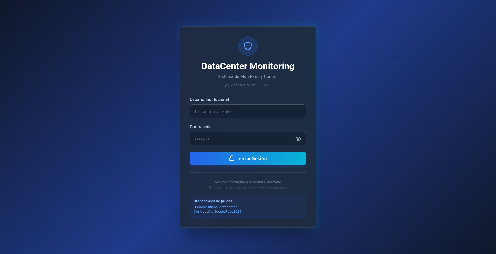

**Campos a completar:**

1. **Usuario**: Ingrese su nombre de usuario institucional (`fiusac_datacenter`)
2. **Contraseña**: Ingrese su contraseña (`SecurePass2025`)

### Paso 3: Iniciar Sesión

1. Haga clic en el botón **"Iniciar Sesión"** para acceder al dashboard.
2. Si las credenciales son correctas, será redirigido al panel principal del sistema.

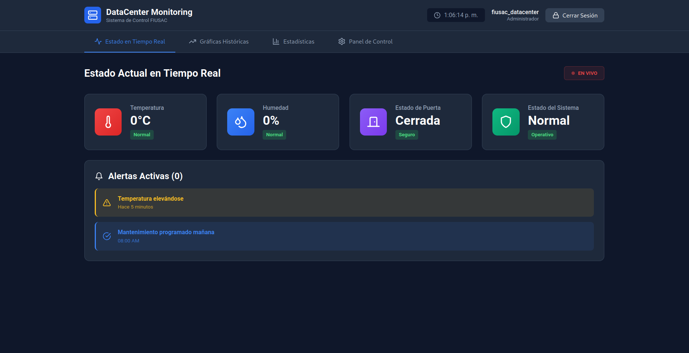

---

## Interfaz del Dashboard

### Navegación Principal

El dashboard está dividido en **4 secciones principales** accesibles desde el menú lateral/superior:

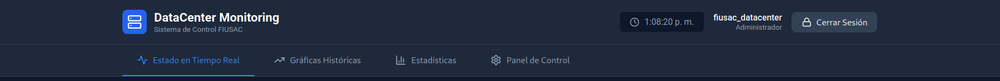

### Barra Superior

La barra superior muestra:

- **Nombre de Usuario**: Usuario actualmente conectado
- **Fecha y Hora**: Fecha y hora actual del sistema

---

## Funcionalidades Principales

### 1. Estado en Tiempo Real

**Ubicación**: `Dashboard > Tiempo Real`

Esta sección muestra el estado actual del data center:

#### Métricas Disponibles

**Temperatura:**

- Temperatura actual en grados Celsius (°C)
- Indicador de color según nivel:
  - 🟢 Verde: Temperatura normal (< 27°C)
  - 🟡 Amarillo: Temperatura elevada (27°C - 29°C)
  - 🔴 Rojo: Temperatura crítica (≥ 29°C)
- Lectura instantánea con estado (Normal/Alta)

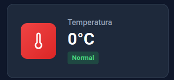

**Humedad:**

- Porcentaje de humedad relativa
- Indicador de color:
  - 🟢 Verde: Humedad normal (< 60%)
  - 🟡 Amarillo: Humedad media (60% - 70%)
  - 🔴 Rojo: Humedad alta (> 70%)

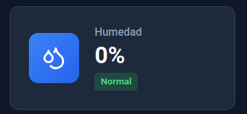

**Estado de Puerta:**

- Estado actual: Abierta/Cerrada
- Indicador visual de seguridad
- Tiempo transcurrido si está abierta
- Último evento registrado

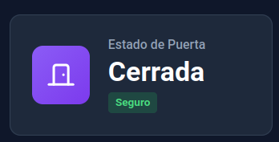

**Estado del Sistema:**

- Estado general: Operativo/Alarma/Mantenimiento
- Código de estado
- Última actualización

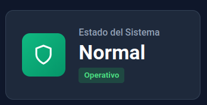

**Panel de Alertas Activas:**

- Contador de alertas en tiempo real
- Lista de eventos recientes con timestamps
- Indicadores visuales por tipo de alerta (⚠️ Advertencia, ℹ️ Información)

**Actualización:** Se refresca automáticamente cada **3 segundos**

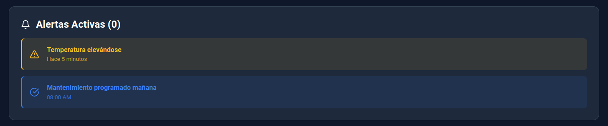

**Indicadores Visuales:**

- **Punto verde parpadeante** indica actualización en vivo
- Badge "EN VIVO" en header de sección

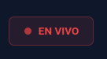

---

### 2. Gráficas Históricas

**Ubicación**: `Dashboard > Gráficas`

**Propósito:** Visualización de tendencias y análisis de datos de los últimos 3 días.

#### Gráfica de Temperatura

- **Rango:** 0°C - 50°C
- **Período:** Últimos 3 días (mínimo)
- **Visualización:** Línea continua con puntos individuales
- **Tooltip:** Hover sobre puntos para ver valor exacto y timestamp
- **Características:**
  - Eje X: Fecha/hora
  - Eje Y: Temperatura en °C
  - Líneas de referencia para umbrales (27°C, 29°C)

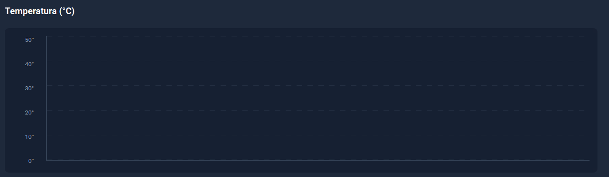

#### 💧 Gráfica de Humedad

- **Rango:** 0% - 100%
- **Período:** Últimos 3 días (mínimo)
- **Visualización:** Línea continua con puntos individuales
- **Tooltip:** Hover sobre puntos para ver valor exacto y timestamp
- **Características:**
  - Eje X: Fecha/hora
  - Eje Y: Humedad en %
  - Líneas de referencia para umbrales (60%, 70%)

  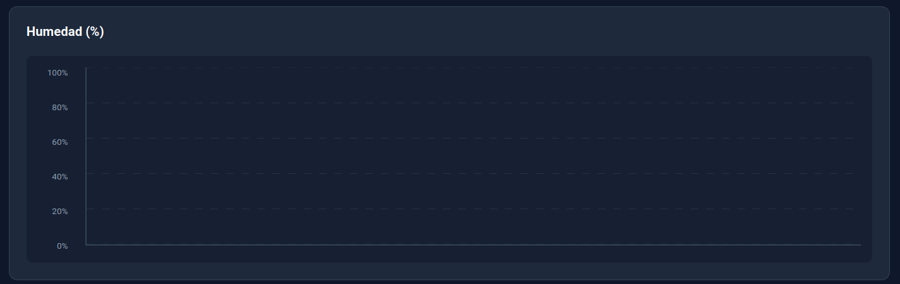

#### Cantidad de Eventos por Tipo

**Gráfica de barras horizontal mostrando:**

- 🔑 **Acceso:** Aperturas/cierres de puerta
- 🌡️ **Temperatura Alta:** Eventos > 28°C (umbral configurable)
- 💧 **Humedad Alta:** Eventos > 70% (umbral configurable)
- 🚨 **Intrusión:** Detecciones de movimiento no autorizado
- 🔧 **Mantenimiento:** Activaciones del modo mantenimiento
- 💨 **Ventilador:** Eventos de activación/desactivación

**Características:**

- Comparación visual rápida
- Contador numérico en cada barra
- Códigos de color por categoría

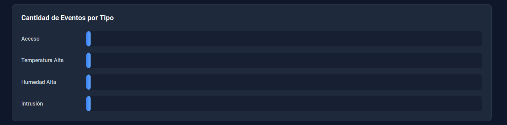

#### Tabla Filtrable: Últimos 50 Eventos Registrados

**Columnas:**

- **Tipo:** Badge visual por categoría de evento
- **Fecha:** Formato YYYY-MM-DD
- **Hora:** Formato 24h (HH:MM:SS)
- **Temperatura:** Valor en °C al momento del evento
- **Descripción:** Detalle completo del evento

**Filtros Disponibles:**

1. **Por Tipo de Evento:**
   - Todos
   - Acceso
   - Temperatura Alta
   - Humedad Alta
   - Intrusión
   - Ventilador
   - Mantenimiento

2. **Por Fecha:**
   - Selector de calendario para filtrar día específico
   - Rango de fechas

3. **Por Rango de Temperatura:**
   - **Temperatura Mínima:** Ej: 20°C
   - **Temperatura Máxima:** Ej: 35°C

**Botón "Limpiar Filtros":** Resetea todos los filtros a valores por defecto

**Límite de Visualización:** 50 eventos. Si hay más resultados, aparece mensaje informativo.

**Actualización:** Se refresca automáticamente cada **3 segundos**

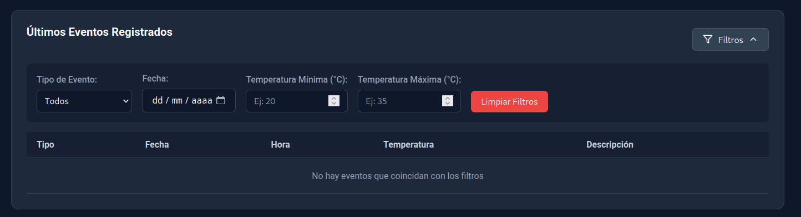

---

### 3. Estadísticas

**Ubicación**: `Dashboard > Estadísticas`

**Propósito:** Análisis de métricas del día actual y resumen de 3 días.

#### Estadísticas del Día (Tarjetas Individuales)

1. **Temperatura Máxima**
   - Valor más alto registrado hoy
   - Hora en que ocurrió
   - Indicador visual rojo

   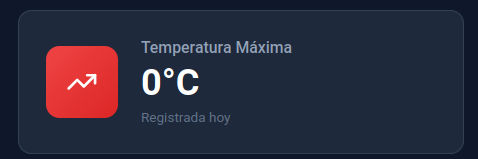

2. **Temperatura Mínima**
   - Valor más bajo registrado hoy
   - Hora en que ocurrió
   - Indicador visual azul

   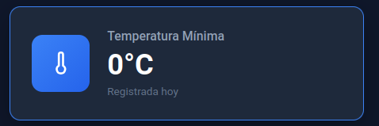

3. **Total de Alarmas**
   - Suma de alertas de temperatura y humedad del día
   - Desglose por tipo
   - Indicador visual amarillo

   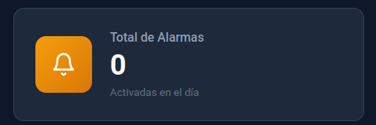

4. **Accesos del Día**
   - Contador de aperturas de puerta autorizadas
   - Comparativo con días anteriores
   - Indicador visual verde

   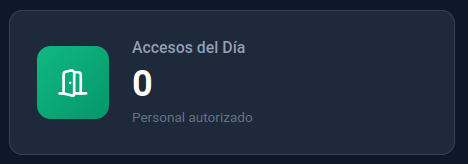

5. **Tiempo Promedio Puerta Abierta**
   - Cálculo basado en eventos de acceso
   - Formato: Xm Ys
   - Comparación con promedio semanal

   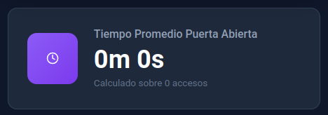

#### Resumen de los Últimos 3 Días

**Panel con 4 métricas calculadas:**

1. **Promedio de Temperatura**
   - Promedio aritmético de todas las lecturas de 3 días
   - Precisión: 1 decimal
   - Comparación con rangos ideales

2. **Promedio de Humedad**
   - Promedio aritmético de todas las lecturas de 3 días
   - Precisión: 1 decimal
   - Indicador de conformidad

3. **Total Accesos (3 días)**
   - Suma de eventos de acceso en el período
   - Distribución por día

4. **Eficiencia del Sistema**
   - Porcentaje basado en lecturas recibidas vs esperadas
   - Fórmula: `(lecturas_recibidas / lecturas_esperadas) * 100`
   - Lecturas esperadas = 3 días × 24h × 60min × 6 lecturas/min
   - Indicador de salud del sistema

**Actualización:** Se refresca automáticamente cada **3 segundos**

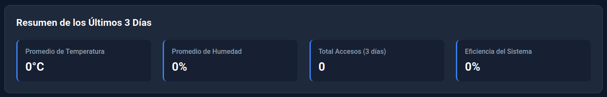

---

### 4. Panel de Control

**Ubicación**: `Dashboard > Panel de Control`

**Propósito:** Control remoto de actuadores del datacenter.

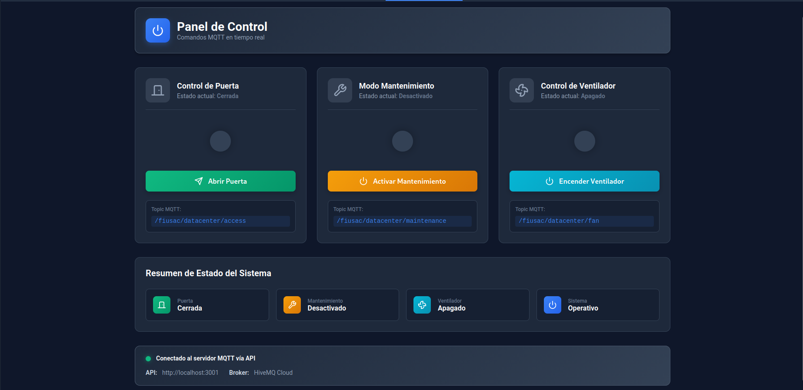

#### Controles Disponibles

##### 1. Control de Puerta 

**Estados:**

- **CERRADA**: Puerta bloqueada (seguro)
- **ABIERTA**: Puerta desbloqueada (acceso permitido)

**Funcionalidad:**

- **Abrir Puerta**: Desbloquea el acceso
- **Cerrar Puerta**: Bloquea el acceso

**Proceso de Apertura:**

1. Click en botón "Abrir Puerta"
2. Sistema envía comando MQTT al topic `/fiusac/datacenter/command/access`
3. Servo motor gira para desbloquear
4. Backend registra evento de acceso
5. Notificación visual de confirmación
6. Estado se actualiza en tiempo real

**Proceso de Cierre:**

1. Click en botón "Cerrar Puerta"
2. Sistema envía comando MQTT
3. Servo motor gira para bloquear
4. Registro del evento
5. Confirmación visual

**Seguridad:**

- No permite abrir si hay alerta activa (excepto en modo emergencia)
- Tiempo máximo de apertura: 5 minutos (luego emite alerta)
- Registro completo de accesos con usuario y timestamp

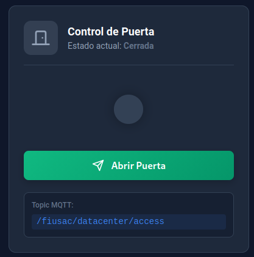

##### 2. Control de Ventilador 💨

**Estados:**

- **OFF**: Ventilador apagado
- **ON**: Ventilador en funcionamiento

**Funcionalidad:**

- **Encender**: Activa ventilador
- **Apagar**: Desactiva ventilador

**Modos de Activación:**

1. **Manual**: Usuario activa desde Panel de Control
2. **Automático**: Sistema activa cuando temperatura > 28°C

**Proceso:**

1. Click en botón "Encender Ventilador" o "Apagar Ventilador"
2. Sistema envía comando MQTT al topic `/fiusac/datacenter/command/fan`
3. Relé activa/desactiva el ventilador
4. Backend registra evento
5. Notificación visual de confirmación

**Nota:**

- El ventilador se desactiva automáticamente cuando temperatura < 26°C
- En modo automático, aparece indicador "AUTO" en el botón

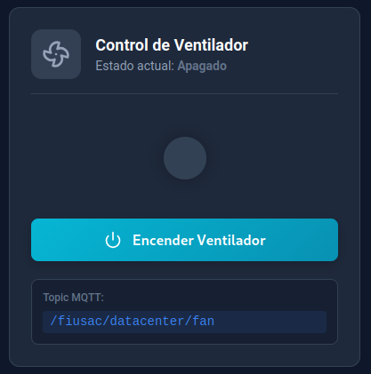

##### 3. Modo Mantenimiento 🔧

**Propósito:** Desactivar alarmas de intrusión durante tareas de mantenimiento.

**Estados:**

- **OFF**: Modo normal de operación
- **ON**: Modo mantenimiento activo

**Funcionalidad:**

- **Activar**: Deshabilita sensor PIR temporalmente
- **Desactivar**: Restaura monitoreo normal

**Proceso de Activación:**

1. Click en botón "Activar Mantenimiento"
2. Sistema muestra diálogo de confirmación
3. Si confirma, envía comando MQTT al topic `/fiusac/datacenter/command/maintenance`
4. Sensor PIR se deshabilita
5. Aparece banner amarillo en todas las vistas indicando "MODO MANTENIMIENTO ACTIVO"
6. LED amarillo se enciende en hardware
7. Registro en base de datos con usuario y hora de inicio

**Proceso de Desactivación:**

1. Click en botón "Desactivar Mantenimiento"
2. Sistema envía comando
3. Sensor PIR vuelve a estar activo
4. Banner desaparece
5. LED amarillo se apaga
6. Registro en base de datos con hora de fin

**IMPORTANTE:**

- NO olvide desactivar modo mantenimiento al terminar
- Sistema queda vulnerable si se deja activo
- Tiempo máximo recomendado: 2 horas
- Después de 2 horas, el sistema emite recordatorio

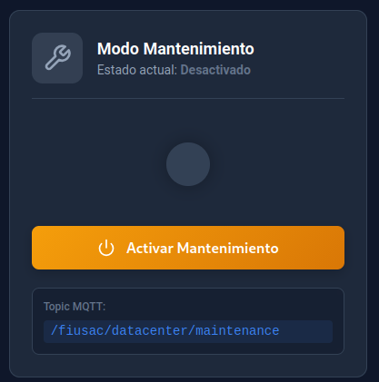

---

#### Panel de Notificaciones

**Ubicación:** Parte inferior del Panel de Control

**Tipos de Notificaciones:**

1. **Éxito (Verde):**
   - "Puerta abierta exitosamente"
   - "Ventilador encendido correctamente"
   - "Modo mantenimiento activado"

2. **Error (Rojo):**
   - "Error al abrir puerta"
   - "Fallo en comunicación MQTT"
   - "Backend no responde"

3. **Advertencia (Amarillo):**
   - "Temperatura crítica - Revisar sistema"
   - "Puerta abierta por más de 5 minutos"

**Duración:** Las notificaciones se auto-ocultan después de 5 segundos

**Límite:** Máximo 5 notificaciones visibles simultáneamente

---

## Guía de Uso

### Caso de Uso 1: Monitoreo Rutinario Diario

**Objetivo**: Verificar que todo funcione correctamente

**Pasos**:

1. Iniciar sesión en el sistema
2. Ir a **"Tiempo Real"**
3. Verificar que todas las métricas estén en rango normal:
   - Temperatura < 27°C
   - Humedad < 70%
   - Sin alertas activas
4. Ir a **"Estadísticas"**
5. Revisar estadísticas del día:
   - Revisar temperatura máxima registrada
   - Verificar cantidad de accesos
   - Confirmar que no hay alarmas inusuales
6. Ir a **"Gráficas"**
7. Revisar tendencias de últimos 3 días
8. Verificar eventos en tabla filtrable
9. Si todo está normal, cerrar sesión

**Tiempo estimado**: 3-5 minutos

---

### Caso de Uso 2: Gestionar Alerta de Temperatura Alta

**Situación**: Temperatura sube a 30°C

**Síntomas**:

- Tarjeta de temperatura en rojo
- Alerta "Temperatura crítica detectada: 30°C"
- Contador de alertas aumenta

**Pasos de Resolución**:

1. Ir a **"Panel de Control"**
2. Verificar estado del ventilador
3. Si está apagado, hacer click en **"Encender Ventilador"**
4. Esperar 2-3 minutos
5. Ir a **"Tiempo Real"** y verificar si temperatura desciende
6. Si temperatura sigue alta:
   - Verificar aire acondicionado externo
   - Revisar carga de servidores
   - Si persiste, contactar al administrador de infraestructura
7. Monitorear gráfica de temperatura en **"Gráficas"**
8. Cuando temperatura vuelva a < 27°C, alerta se resolverá automáticamente
9. Documentar incidente en bitácora externa

**Tiempo estimado**: 5-10 minutos

---

### Caso de Uso 3: Autorizar Acceso al Data Center

**Situación**: Personal técnico necesita ingresar al data center

**Pasos**:

1. Iniciar sesión en el sistema
2. Ir a **"Panel de Control"**
3. Hacer click en **"Abrir Puerta"**
4. Sistema mostrará notificación: "Puerta abierta exitosamente"
5. Personal puede ingresar
6. Ir a **"Tiempo Real"** para monitorear estado de puerta
7. Si personal necesita estar más de 5 minutos:
   - Considerar activar **"Modo Mantenimiento"**
8. Cuando personal salga, hacer click en **"Cerrar Puerta"**
9. Verificar en **"Gráficas"** > Tabla de eventos que acceso quedó registrado

**Tiempo estimado**: 1-2 minutos

---

### Caso de Uso 4: Realizar Mantenimiento Preventivo

**Situación**: Técnico debe ingresar para limpieza y revisión de equipos

**Pasos**:

1. Iniciar sesión en el sistema
2. Ir a **"Panel de Control"**
3. Hacer click en **"Activar Mantenimiento"**
4. Confirmar en diálogo emergente
5. Verificar que aparece banner amarillo: "MODO MANTENIMIENTO ACTIVO"
6. Hacer click en **"Abrir Puerta"**
7. Personal ingresa al data center
8. Durante el mantenimiento:
   - Sistema NO generará alertas de intrusión
   - Temperatura y humedad siguen monitoreándose
   - Ventilador puede activarse si es necesario
9. Al terminar mantenimiento:
   - Hacer click en **"Cerrar Puerta"**
   - Hacer click en **"Desactivar Mantenimiento"**
   - Verificar que banner amarillo desaparece
10. Ir a **"Gráficas"** > Tabla de eventos
11. Filtrar por tipo "Mantenimiento"
12. Verificar que evento quedó registrado con inicio y fin

**Tiempo estimado**: Variable según duración de mantenimiento

---

### Caso de Uso 5: Investigar Alerta de Intrusión

**Situación**: Sistema detecta movimiento no autorizado

**Síntomas**:

- Alerta "Movimiento detectado" en panel de alertas
- Badge rojo en tabla de eventos
- Estado del sistema cambia a "ALERTA"

**Pasos de Investigación**:

1. **INMEDIATO**: Ir a **"Tiempo Real"**
2. Verificar hora exacta de la alerta
3. Ir a **"Gráficas"** > Tabla de eventos
4. Filtrar por tipo "Intrusión"
5. Revisar eventos de acceso previos:
   - ¿Alguien abrió la puerta recientemente?
   - ¿Hay evento de cierre correspondiente?
6. Verificar estado de puerta en **"Tiempo Real"**
7. Si puerta está cerrada y no hay acceso autorizado:
   - Contactar a seguridad física
   - Revisar cámaras externas (si disponibles)
   - Considerar cerrar puerta remotamente si estaba abierta
8. Si era falsa alarma (alguien olvidó activar modo mantenimiento):
   - Documentar en bitácora
   - Recordar al personal procedimiento correcto
9. Monitorear sistema durante próximos 15 minutos

**Tiempo estimado**: 5-15 minutos

---

### Caso de Uso 6: Análisis de Tendencias Mensuales

**Objetivo**: Generar reporte mensual de operación

**Pasos**:

1. Iniciar sesión
2. Ir a **"Estadísticas"**
3. Anotar métricas de resumen de 3 días
4. Ir a **"Gráficas"**
5. Analizar gráfica de temperatura:
   - Identificar picos y valles
   - Detectar patrones por hora del día
6. Analizar gráfica de humedad:
   - Verificar estabilidad
   - Identificar correlación con temperatura
7. Revisar gráfica de eventos por tipo:
   - Total de accesos del mes
   - Cantidad de alarmas
   - Frecuencia de intrusiones
8. Usar tabla filtrable:
   - Filtrar por cada tipo de evento
   - Exportar datos (si función disponible)
9. En **"Estadísticas"**:
   - Anotar eficiencia del sistema
   - Calcular disponibilidad
10. Compilar información en reporte externo

**Tiempo estimado**: 20-30 minutos

---

## Interpretación de Datos

### Rangos Normales de Operación

#### Temperatura

- **IDEAL**: 18°C - 24°C
- **ACEPTABLE**: 24°C - 27°C
- **ADVERTENCIA**: 27°C - 29°C
- **CRÍTICO**: > 29°C

**Contexto**:

- Servidores operan mejor en temperaturas bajas
- Cada °C adicional reduce vida útil de componentes
- > 30°C puede causar throttling de CPU
- > 35°C riesgo de daño permanente

#### Humedad

- **IDEAL**: 40% - 55%
- **ACEPTABLE**: 55% - 60%
- **ADVERTENCIA**: 60% - 70%
- **CRÍTICO**: > 70% o < 30%

**Contexto**:

- Humedad baja (< 30%): Riesgo de electricidad estática
- Humedad alta (> 70%): Riesgo de corrosión y cortocircuitos
- Rango ideal minimiza ambos riesgos

### Interpretación de Gráficas

#### Patrones Normales

**Temperatura**:

- Variación diurna normal: 3-5°C
- Picos durante horario laboral (más carga de servidores)
- Valles durante madrugada
- Gradiente suave, sin cambios bruscos

**Humedad**:

- Variación diurna normal: 5-10%
- Inversamente correlacionada con temperatura
- Estabilidad relativa durante el día

#### Patrones Anormales

**Temperatura**:

- 🔴 **Tendencia ascendente sostenida**: Posible fallo de A/C
- 🔴 **Picos súbitos**: Sobrecarga de servidores o fallo de ventilación
- 🔴 **Oscilaciones grandes**: Sistema de enfriamiento inestable

**Humedad**:

- 🔴 **Aumento súbito**: Posible filtración de agua
- 🔴 **Disminución drástica**: Fallo de humidificador o A/C en exceso
- 🔴 **Alta correlación con temperatura**: Sistema desbalanceado

### Interpretación de Estadísticas

#### Eficiencia del Sistema

- **> 95%**: Excelente - Sistema muy confiable
- **90% - 95%**: Bueno - Operación normal
- **80% - 90%**: Aceptable - Revisar conectividad
- **< 80%**: Deficiente - Requiere intervención urgente

**Causas de baja eficiencia**:

- Problemas de conectividad MQTT
- Fallo en sensores
- Backend inestable
- Raspberry Pi reiniciándose

#### Tiempo Promedio Puerta Abierta

- **< 2 minutos**: Normal - Accesos rápidos
- **2 - 5 minutos**: Aceptable - Tareas breves
- **> 5 minutos**: Revisar - Posible olvido de cerrar

---

## Alertas y Notificaciones

### Tipos de Alertas y Su Interpretación

### 1. Alerta de Temperatura Alta

**Condición de Disparo:** Temperatura > 28°C

**Apariencia en Sistema:**

- Badge rojo en tabla de eventos
- Tarjeta de temperatura en color rojo
- Contador incrementa en gráfica de barras
- Descripción: "Temperatura crítica detectada: XXºC (umbral: 28ºC)"

**Acciones Recomendadas:**

1. Verificar funcionamiento del aire acondicionado
2. Activar ventilador manualmente desde Panel de Control
3. Revisar carga de servidores
4. Si persiste > 5 minutos, activar protocolo de enfriamiento de emergencia
5. Documentar en bitácora

**Reseteo Automático:** Cuando temperatura vuelve a < 28°C

**Nivel de Criticidad:** ALTO

---

### 2. Alerta de Humedad Alta

**Condición de Disparo:** Humedad > 70%

**Apariencia en Sistema:**

- Badge azul claro en tabla de eventos
- Contador incrementa en gráfica de barras
- Descripción: "Humedad elevada detectada: XX% (umbral: 70%)"

**Acciones Recomendadas:**

1. Verificar sistema de deshumidificación
2. Revisar fugas de agua en techo/paredes
3. Aumentar ventilación si temperatura lo permite
4. Revisar condensación en equipos
5. Si > 75%, considerar apagar equipos no críticos

**Riesgo:** Humedad alta puede causar corrosión y cortocircuitos

**Nivel de Criticidad:** MEDIO-ALTO

---

### 3. Alerta de Acceso

**Condición de Disparo:**

- Puerta abierta/cerrada (eventos normales)
- Puerta abierta > 5 minutos (advertencia)

**Tipos de Eventos de Acceso:**

- **"Puerta OPEN"** - Apertura autorizada
- **"Puerta CLOSED"** - Cierre normal
- **"Puerta abriendo"** - Comando desde web
- **"Puerta cerrando"** - Comando desde web

**Registro:** Incluye usuario que realizó la acción y timestamp

**Acciones Recomendadas:**

- Si apertura es > 5 min: Verificar si personal está dentro
- Si no hay personal autorizado: Cerrar remotamente desde Panel de Control
- Si > 10 min: Contactar a seguridad

**Nivel de Criticidad:** BAJO (normal) / MEDIO (> 5 min)

---

### 4. Alerta de Intrusión

**Condición de Disparo:** Sensor PIR detecta movimiento cuando modo mantenimiento está OFF

**Apariencia en Sistema:**

- Badge rojo oscuro en tabla de eventos
- Estado del sistema cambia a "ALERTA"
- Descripción: "Movimiento detectado"
- Incrementa contador en gráfica

**Acciones Recomendadas:**

1. **INMEDIATO:** Verificar cámaras de seguridad
2. Revisar registro de accesos autorizados en tabla de eventos
3. Si no hay personal autorizado: Activar protocolo de seguridad
4. Contactar a personal de vigilancia
5. Verificar estado de puerta
6. Documentar incidente detalladamente

**Nota:** Si estás realizando mantenimiento, activa "Modo Mantenimiento" para evitar falsas alarmas

**Nivel de Criticidad:** CRÍTICO

---

### 5. Evento de Ventilador

**Tipos:**

- "Ventilador encendido" - Activación manual o automática
- "Ventilador apagado" - Desactivación manual

**Descripción incluye:**

- Modo de activación (Manual/Automático)
- Temperatura al momento del evento
- Usuario (si fue manual)

**No es una alerta crítica,** solo registro de activaciones

**Nivel de Criticidad:** INFORMATIVO

---

### 6. Evento de Mantenimiento

**Tipos:**

- "Mantenimiento activado" - Inicio de modo mantenimiento
- "Mantenimiento desactivado" - Fin de modo mantenimiento

**Incluye:**

- Usuario que activó/desactivó el modo
- Duración total (en evento de desactivación)

**Propósito:** Auditoría de intervalos de mantenimiento

**Nivel de Criticidad:** INFORMATIVO

---

## Sistema de Actualización Automática

El dashboard se actualiza automáticamente SIN necesidad de refrescar la página:

### Intervalos de Actualización

| Sección | Frecuencia | Datos que se actualizan |
|---------|-----------|-------------------------|
| **Estado en Tiempo Real** | 3 segundos | Temp, humedad, estado puerta, alertas |
| **Gráficas Históricas** | 3 segundos | Nuevos puntos en gráficas, eventos |
| **Estadísticas** | 3 segundos | Promedios, contadores, métricas |
| **Panel de Control** | Al cargar página | Estado inicial de actuadores |
| **Reloj del Header** | 1 segundo | Hora actual del sistema |

### Indicadores Visuales de "En Vivo"

- **Punto verde parpadeante** en sección "Estado en Tiempo Real"
- Badge "EN VIVO" en header de sección
- Notificaciones emergentes al detectar nuevos eventos
- Animaciones suaves al actualizar valores

---

## Solución de Problemas

### Problema 1: No se muestran datos en tiempo real

**Síntomas**:

- Tarjetas vacías o sin actualizar
- Valores en "---" o "N/A"
- Sin datos en gráficas

**Posibles Causas y Soluciones**:

1. **Conexión a Internet**
   - Verificar conexión WiFi/Ethernet
   - Probar abrir otro sitio web
   - Si conexión es lenta, esperar 10-15 segundos

2. **Backend Desconectado**
   - Contactar al administrador del sistema
   - Verificar que servidor backend esté en ejecución
   - URL: `http://[servidor]:3001/api/health`

3. **Raspberry Pi Sin Conexión**
   - Verificar que Raspberry Pi esté encendida (LED verde)
   - Verificar conexión WiFi de Raspberry Pi
   - Reiniciar Raspberry Pi si es necesario

4. **Problemas de MQTT**
   - Administrador debe verificar broker HiveMQ
   - Revisar logs en backend
   - Reiniciar servicio MQTT

---

### Problema 2: Comandos no funcionan (puerta, ventilador)

**Síntomas**:

- Click en botón no hace nada
- Notificación de error aparece
- Estado no cambia después de comando

**Posibles Causas y Soluciones**:

1. **Backend no responde**
   - Verificar conexión a internet
   - Refrescar página (F5)
   - Cerrar sesión y volver a iniciar

2. **MQTT Desconectado**
   - Esperar 30 segundos y reintentar
   - Verificar en "Tiempo Real" si otros datos se actualizan
   - Contactar administrador si persiste

3. **Hardware no responde**
   - Verificar que Raspberry Pi esté encendida
   - Verificar conexión de servomotor/relé
   - Administrador debe revisar hardware

4. **Permisos insuficientes**
   - Verificar que su usuario tenga permisos de control
   - Contactar administrador para revisar permisos

---

### Problema 3: Datos inconsistentes o erróneos

**Síntomas**:

- Temperatura muestra valores imposibles (< 0°C o > 50°C)
- Humedad fuera de rango (< 0% o > 100%)
- Gráficas con saltos abruptos

**Posibles Causas y Soluciones**:

1. **Sensor DHT11 con fallo**
   - Verificar si lecturas se recuperan solas en 1-2 minutos
   - Si persiste, reportar a administrador
   - Administrador debe revisar conexiones físicas

2. **Interferencia electromagnética**
   - Verificar si hay equipos nuevos cerca de sensores
   - Alejar fuentes de interferencia

3. **Calibración necesaria**
   - Reportar a administrador
   - Comparar con termómetro físico
   - Solicitar recalibración de sensores

---

### Problema 4: Sesión se cierra sola

**Síntomas**:

- Vuelve a pantalla de login inesperadamente
- Mensaje "Sesión expirada"

**Posibles Causas y Soluciones**:

1. **Timeout de sesión**
   - Sesión expira después de 60 minutos de inactividad
   - Volver a iniciar sesión
   - Mantener pestaña activa para evitar timeout

2. **Múltiples sesiones**
   - Sistema permite solo 1 sesión simultánea por usuario
   - Si inicia sesión en otro dispositivo, cierra la anterior
   - Cerrar siempre sesión al terminar

3. **Servidor reiniciado**
   - Si backend se reinicia, todas las sesiones se cierran
   - Volver a iniciar sesión
   - Datos históricos no se pierden

---

### Problema 5: Gráficas no cargan

**Síntomas**:

- Área de gráficas vacía
- Loading infinito
- Mensaje de error

**Posibles Causas y Soluciones**:

1. **Falta de datos históricos**
   - Si sistema es nuevo, esperar que se acumulen datos
   - Mínimo 1 hora de datos para visualizar
   - Verificar en tabla de eventos si hay registros

2. **Rango de fechas inválido**
   - Limpiar filtros
   - Refrescar página

3. **Base de datos con problemas**
   - Contactar administrador
   - Administrador debe revisar MongoDB Atlas

4. **Navegador desactualizado**
   - Actualizar navegador a última versión
   - Probar en otro navegador

---

### Problema 6: Alertas no desaparecen

**Síntomas**:

- Alerta permanece aunque condición se normalizó
- Contador de alertas no decrece

**Posibles Causas y Soluciones**:

1. **Actualización pendiente**
   - Esperar 3 segundos (ciclo de actualización)
   - Si no se resuelve, refrescar página (F5)

2. **Condición no resuelta completamente**
   - Verificar que temperatura < 28°C o humedad < 70%
   - Debe mantenerse bajo umbral por al menos 30 segundos

3. **Error en lógica de resolución**
   - Reportar a administrador con captura de pantalla
   - Incluir valores actuales y timestamp

---

## Preguntas Frecuentes

### Generales

**P: ¿Puedo acceder desde mi teléfono móvil?**
R: Sí, el sistema es responsive y se adapta a dispositivos móviles. Recomendamos usar Chrome o Safari móvil para mejor experiencia.

**P: ¿Los datos se guardan si el sistema se apaga?**
R: Sí, todos los datos se almacenan en MongoDB Atlas (nube), por lo que no se pierden aunque el servidor local se apague.

**P: ¿Puedo descargar los datos históricos?**
R: Actualmente no hay función de exportación directa. Contacte al administrador para solicitar un reporte de datos específicos.

**P: ¿Cuánto tiempo se conservan los datos?**
R: Los datos se conservan indefinidamente en la base de datos. Las gráficas muestran últimos 3 días por defecto, pero se pueden consultar períodos mayores si es necesario.

### Funcionalidad

**P: ¿Qué pasa si abro la puerta y olvido cerrarla?**
R: Después de 5 minutos, el sistema emite una alerta. Puede cerrarla remotamente desde el Panel de Control en cualquier momento.

**P: ¿El ventilador se apaga solo?**
R: Sí, si fue activado automáticamente, se apagará cuando la temperatura baje de 26°C. Si lo activó manualmente, debe apagarlo manualmente.

**P: ¿Puedo ver quién realizó cada acción?**
R: Sí, en la tabla de eventos se registra el usuario que ejecutó cada comando (abrir puerta, activar ventilador, etc.).

**P: ¿Cuántas alertas puede haber simultáneamente?**
R: No hay límite. Todas las alertas activas aparecen en el panel de "Estado en Tiempo Real".

### Seguridad

**P: ¿Puedo compartir mi usuario con un compañero?**
R: No, está estrictamente prohibido. Cada usuario debe tener sus propias credenciales para fines de auditoría.

**P: ¿Qué pasa si intento acceder con contraseña incorrecta?**
R: Después de 3 intentos fallidos, su cuenta se bloqueará por 15 minutos. Contacte al administrador si olvidó su contraseña.

**P: ¿Las comunicaciones están encriptadas?**
R: Sí, las conexiones MQTT usan TLS y las conexiones HTTP pueden configurarse con HTTPS en producción.

### Mantenimiento

**P: ¿Debo activar modo mantenimiento para tareas breves?**
R: Si va a estar dentro del data center por más de 2 minutos, sí, active el modo mantenimiento para evitar falsas alarmas.

**P: ¿Qué pasa si olvido desactivar modo mantenimiento?**
R: El sistema seguirá funcionando, pero las alertas de intrusión estarán deshabilitadas. Después de 2 horas, recibirá un recordatorio. Es importante desactivarlo al terminar.

**P: ¿Puedo realizar mantenimiento sin usar el sistema web?**
R: Sí, puede ingresar físicamente sin usar el sistema, pero NO se registrará en logs y se generarán alertas de intrusión si el modo mantenimiento no está activo.

### Técnicas

**P: ¿Con qué frecuencia se actualiza la temperatura?**
R: El sensor DHT11 toma lecturas cada 2 segundos, pero el sistema muestra actualización cada 3 segundos en el frontend.

**P: ¿Qué precisión tienen los sensores?**
R: DHT11 tiene precisión de ±2°C para temperatura y ±5% para humedad. Son lecturas aproximadas, suficientes para monitoreo general.

**P: ¿Qué pasa si se va la electricidad?**
R: La Raspberry Pi se apagará si no hay UPS. Al regresar la corriente, debe reiniciarse manualmente. Los datos en la nube (MongoDB) no se pierden.

**P: ¿Puedo cambiar los umbrales de temperatura y humedad?**
R: Los umbrales están configurados en el código del backend. Contacte al administrador para modificarlos. Valores actuales: Temperatura > 28°C, Humedad > 70%.
