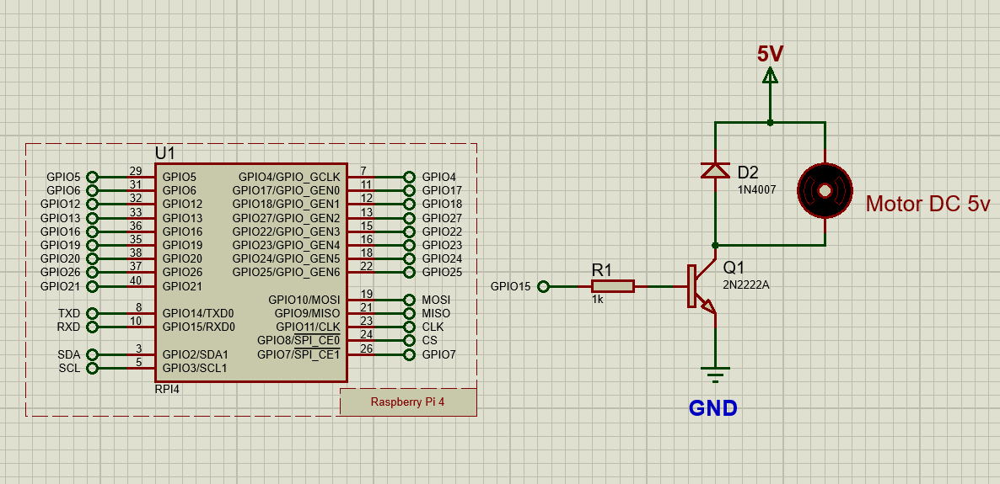
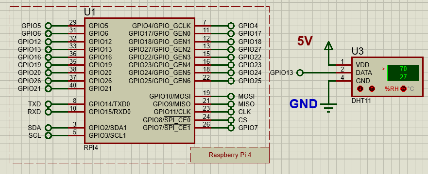

# 🔌 ACYE1_DICIEMBRE_2025_G1

> Documentación técnica del proyecto de Arquitectura de Computadoras y Ensambladores 1

## 📋 Tabla de Contenidos

- [Tecnologías Utilizadas](#-tecnologías-utilizadas)
- [Instalación y Despliegue](#-instalación-y-despliegue)
- [Conexión de Componentes Electrónicos](#conexión-de-componentes-electrónicos)
  - [Pantalla LCD con I2C](#1-pantalla-lcd-con-módulo-i2c)
  - [LED RGB](#2-led-rgb)
  - [Servomotor SG90](#3-servomotor-sg90)
  - [Motor DC](#4-motor-dc)
  - [Sensor DHT11](#5-sensor-dht11)

---

## 🛠️ Tecnologías Utilizadas

### Hardware

- **Raspberry Pi** (con GPIO habilitado)
- **Pantalla LCD 16x2** con módulo I2C
- **LED RGB**
- **Servomotor SG90**
- **Motor DC**
- **Sensor DHT11** (Temperatura y Humedad)

### Software

- **Python 3.x**
- **Adafruit CircuitPython Libraries** - Para control de sensores y componentes
- **RPi.GPIO** - Control de pines GPIO de Raspberry Pi
- **RPLCD** - Librería para control de pantallas LCD
- **smbus2** - Comunicación I2C
- **pyserial** - Comunicación serial
- **rpi_ws281x** - Control de LEDs NeoPixel

---

## 🚀 Instalación y Despliegue

### Requisitos Previos

- Raspberry Pi con Raspberry Pi OS instalado
- Python 3.x instalado
- Acceso a terminal/SSH
- Permisos de superusuario (sudo)

### Pasos para la Instalación

1. **Clonar o descargar el proyecto**

   ```bash
   git clone https://github.com/Farot30/ACYE1_DICIEMBRE_2025_G1/tree/Rasp_pi?tab=readme-ov-file
   ```

2. **Crear un entorno virtual (recomendado)**

   ```bash
   python3 -m venv venv
   source venv/bin/activate
   ```

3. **Instalar las dependencias**

   ```bash
   pip install -r requirements.txt
   ```

4. **Habilitar interfaces de hardware**

   Ejecutar la configuración de Raspberry Pi:

   ```bash
   sudo raspi-config
   ```

   Habilitar:
   - **I2C**: Interface Options → I2C → Yes
   - **SPI**: Interface Options → SPI → Yes
   - Reiniciar después de los cambios

5. **Verificar permisos GPIO**

   ```bash
   sudo usermod -a -G gpio,i2c,spi $USER
   ```

   Cerrar sesión y volver a iniciar para aplicar cambios.

6. **Ejecutar el proyecto**

   ```bash
   # Asegurarse de estar en el directorio del proyecto
   python3 main.py
   ```

### Solución de Problemas

- **Error de permisos GPIO**: Ejecutar con `sudo python3 main.py`
- **Módulo I2C no encontrado**: Verificar que I2C esté habilitado con `ls /dev/i2c*`
- **Sensor DHT11 no responde**: Verificar conexiones y usar resistencia pull-up de 10kΩ
- **Dependencias faltantes**: Reinstalar con `pip install --upgrade -r requirements.txt`

---

## 🔧 Conexión de Componentes Electrónicos

### 1. Pantalla LCD con Módulo I2C

La pantalla LCD utiliza comunicación I2C para reducir el número de pines necesarios.

**Especificaciones:**

- **Protocolo:** I2C
- **Voltaje:** 5V
- **Pines utilizados:** SDA, SCL


---

### 2. LED RGB

Control de iluminación mediante LED RGB para señalización visual.

**Especificaciones:**

- **Tipo:** Ánodo/Cátodo común
- **Voltaje:** 3.3V - 5V
- **Pines:** R (Rojo), G (Verde), B (Azul)


---

### 3. Servomotor SG90

Servomotor de alta precisión para control de posición angular.

**Especificaciones:**

- **Torque:** 1.8 kg/cm
- **Velocidad:** 0.1 s/60°
- **Ángulo de rotación:** 180°
- **Voltaje:** 4.8V - 6V


---

### 4. Motor DC

Motor de corriente continua para aplicaciones de movimiento rotatorio.

**Especificaciones:**

- **Voltaje:** 3V - 6V



---

### 5. Sensor DHT11

Sensor digital de temperatura y humedad ambiente.

**Especificaciones:**

- **Rango de temperatura:** 0°C a 50°C
- **Rango de humedad:** 20% a 90%
- **Precisión:** ±2°C, ±5% HR
- **Protocolo:** Single-wire serial



---

## 📚 Referencias

- [Documentación Arduino](https://www.arduino.cc/)
- [Datasheet DHT11](https://www.mouser.com/datasheet/2/758/DHT11-Technical-Data-Sheet-Translated-Version-1143054.pdf)
- [Especificaciones SG90](http://www.ee.ic.ac.uk/pcheung/teaching/DE1_EE/stores/sg90_datasheet.pdf)

---

## 👥 Equipo

**Grupo 1 - ACYE1**  
Universidad de San Carlos de Guatemala  
Diciembre 2025
