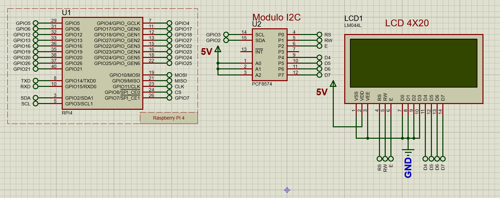
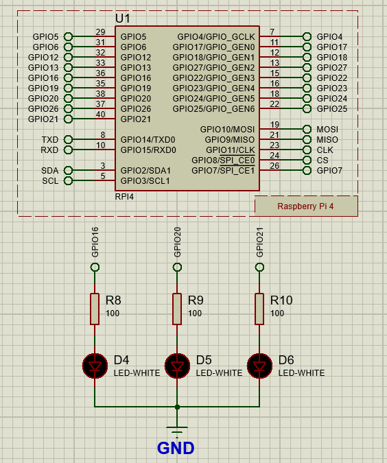
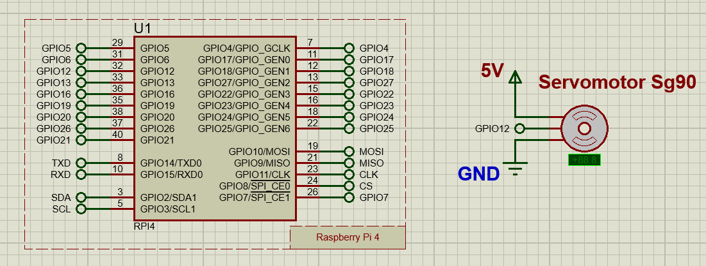
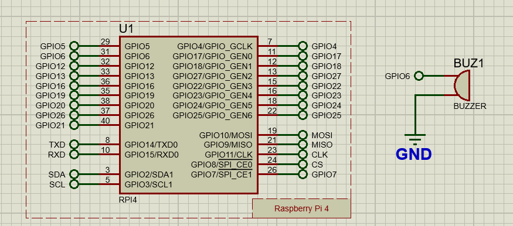
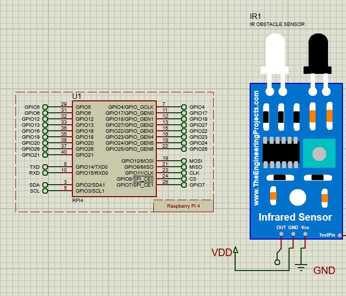

# 🔌 ACYE1_DICIEMBRE_2025_G1

> Documentación técnica del proyecto de Arquitectura de Computadoras y Ensambladores 1

## 📋 Tabla de Contenidos
- [Conexión de Componentes Electrónicos](#conexión-de-componentes-electrónicos)
  - [Pantalla LCD con I2C](#1-pantalla-lcd-con-módulo-i2c)
  - [LED RGB](#2-led-rgb)
  - [Servomotor SG90](#3-servomotor-sg90)
  - [Motor DC](#4-motor-dc)
  - [Sensor DHT11](#5-sensor-dht11)

---

## 🔧 Conexión de Componentes Electrónicos

### 1. Pantalla LCD con Módulo I2C

La pantalla LCD utiliza comunicación I2C para reducir el número de pines necesarios.

**Especificaciones:**
- **Protocolo:** I2C
- **Voltaje:** 5V
- **Pines utilizados:** SDA, SCL

---

### 2. LED RGB

Control de iluminación mediante LED RGB para señalización visual.

**Especificaciones:**
- **Tipo:** Ánodo/Cátodo común
- **Voltaje:** 3.3V - 5V
- **Pines:** R (Rojo), G (Verde), B (Azul)

---

### 3. Servomotor SG90

Servomotor de alta precisión para control de posición angular.

**Especificaciones:**
- **Torque:** 1.8 kg/cm
- **Velocidad:** 0.1 s/60°
- **Ángulo de rotación:** 180°
- **Voltaje:** 4.8V - 6V

---

### 4. Motor DC

Motor de corriente continua para aplicaciones de movimiento rotatorio.

**Especificaciones:**
- **Voltaje:** 3V - 6V

---

### 5. Sensor DHT11

Sensor digital de temperatura y humedad ambiente.

**Especificaciones:**
- **Rango de temperatura:** 0°C a 50°C
- **Rango de humedad:** 20% a 90%
- **Precisión:** ±2°C, ±5% HR
- **Protocolo:** Single-wire serial

---

### 6. Buzzer

Sensor digital de temperatura y humedad ambiente.

**Especificaciones:**   
-- **Frecuencia de Trabajo:** 100Hz a 10KHz   
-- **Corriente de Consumo:**  30 mA (aproximada)   
-- **Impedancia:** 16Ω

### 7. Buzzer

Sensor digital de temperatura y humedad ambiente.

**Especificaciones:**   
-- **Voltaje de operación:** 3.3V ~ 5V DC    
-- **Corriente de operación:**  >15 mA    
-- **Distancia de prueba:** 1 mm a 25 mm    
-- **Tipo:** TCRT50   
-- **Chip:** LM393    
-- **Dimensiones:** 3.2 x 1.4 cm

## 📚 Referencias

- [Documentación Arduino](https://www.arduino.cc/)
- [Datasheet DHT11](https://www.mouser.com/datasheet/2/758/DHT11-Technical-Data-Sheet-Translated-Version-1143054.pdf)
- [Especificaciones SG90](http://www.ee.ic.ac.uk/pcheung/teaching/DE1_EE/stores/sg90_datasheet.pdf)

---

## 👥 Equipo

**Grupo 1 - ACYE1**  
Universidad de San Carlos de Guatemala  
Diciembre 2025

